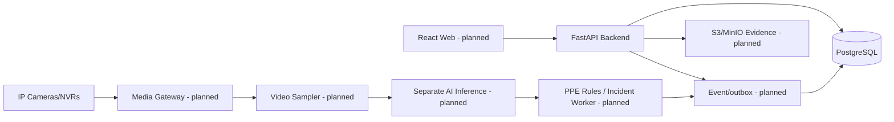

# PPE Construction — Backend V2

> **Status: DEVELOPMENT FOUNDATION (Phase 1), NOT PRODUCTION READY.**
> This repository is a clean V2 backend starter derived from `PPE_Construction-main.zip`. Existing V1 production code and its model weights are **not** part of this package. Nothing has been deployed or migrated. No camera stream or inference worker runs here.

## Project goal

Build a multi-site PPE monitoring platform that supports **50–100+ cameras**, with **FastAPI business backend**, **PostgreSQL**, and **independent media + AI inference services**. Model changes must not require business-API changes if they preserve the versioned inference contract. Camera/NVR access and model weights are outside the business backend.

### Architecture at a glance



### What is already implemented (Phase 1)

- `app/main.py`: FastAPI, liveness/readiness checks, API v1 routers.
- `app/api/auth.py`: Argon2 password verification, opaque bearer-token sessions, logout.
- `app/api/sites.py`: organization membership checks, site/camera CRUD *subset* (list/create).
- `app/api/incidents.py`: tenant-scoped **read-only** incident listing.
- `app/db/models.py`: SQLAlchemy models for organizations, users, memberships, sessions, sites, cameras, model versions/assignments, incidents, evidence assets, audit logs.
- `alembic/versions/`: initial migration for the schema.
- `app/contracts/inference.py`: Pydantic **request/response definitions only** (no inference server).
- `contracts/`: current exported OpenAPI and JSON Schema snapshots.
- `tests/`: executable unit/API/contract tests using an isolated SQLite *test only* database.

**Not implemented:** Model Registry API/assignment endpoints; model loading; RTSP processing; secured service-to-service ingestion; event creation; incident transitions; evidence upload; notification delivery; queue/worker; enterprise identity; production rate limiting, hardened deployment, end-to-end GPU load testing. See [phase roadmap](docs/PHASE_ROADMAP.md).

## Repository guide

| Path | What belongs there |
| --- | --- |
| `app/api/` | Public business API routers and typed validation |
| `app/db/` | SQLAlchemy models and session management |
| `app/contracts/` | Model-agnostic inference contracts, no YOLO imports |
| `alembic/` | Reviewed forward database migrations |
| `contracts/` | Exported machine-readable OpenAPI/JSON Schema |
| `docs/` | Architecture, API, ERD, specs, threat model, roadmap, runbooks |
| `tests/` | Executable Phase 1 tests, fixtures, architecture checks |
| `tests/specs/` | **Not yet automated** acceptance cases for future phases |
| `AGENTS.md` | Binding coding-agent working rules |
| `agent.md` | Compact prompt to paste into a coding agent |

## Prerequisites

- Windows PowerShell or Bash, Git, Python **3.12 or 3.13 recommended**. The user's Python 3.14 environment was not validated against every dependency.
- Docker Desktop (Linux containers) with Docker Compose for **local PostgreSQL 17**.
- Dedicated local development DB only. Never point migrations/tests at a production database.

## Quick start — PowerShell

```powershell
# In the extracted ppe-backend-v2-starter folder
py -3.12 -m venv .venv
.\.venv\Scripts\Activate.ps1
python -m pip install --upgrade pip
python -m pip install -r requirements-dev.txt
Copy-Item .env.example .env

docker compose up -d postgres
docker compose ps
python -m alembic upgrade head
python -m app.scripts.bootstrap --email admin@example.com --organization "Construction Demo"
python -m uvicorn app.main:app --reload --host 127.0.0.1 --port 8000
```

Use `py -m venv .venv` if Python 3.12 is not installed and verify the chosen interpreter is compatible. `.env.example` and `compose.yaml` include **local-only placeholder DB credentials**. Change them for any shared environment and never commit `.env`.

Dev API docs: http://127.0.0.1:8000/docs (only when `ENABLE_API_DOCS=true`). Liveness: http://127.0.0.1:8000/health/live. Readiness requires DB: http://127.0.0.1:8000/health/ready.

### Run existing tests

```powershell
python -m pytest -q
python -m compileall -q app tests
python -m alembic check
python scripts_export_contracts.py
python scripts/verify_contracts.py
python scripts/check_architecture.py
```

**Caution:** `alembic check` and `alembic upgrade` connect to the DB in `DATABASE_URL`; inspect `.env` before running. Export the contract after intentionally changing the API; compare `git diff -- contracts/` and commit the snapshots with the change. `pytest` uses a temporary SQLite DB, so passing it **does not prove PostgreSQL compatibility**. Run PostgreSQL migration checks and CI integration tests before merge.

### Local API smoke test

1. Bootstrap the first account using the console command above, and store its password safely.
2. Open Swagger `/docs`, call `POST /api/v1/auth/login`, then authorize using the bearer token.
3. Call `GET /api/v1/auth/me` and copy your organization ID.
4. Call `POST /api/v1/organizations/{organization_id}/sites`, then add a camera with an opaque `stream_ref`, e.g. `stream:building-a/gate-01`.
5. Confirm `/incidents` gives a valid empty list and logout invalidates the token.

No RTSP URL or camera password is accepted in `stream_ref`. Keep API host on `127.0.0.1` during development.

## Contracts, database, architecture

- [ERD](docs/ERD.md) — actual Phase 1 tables, tenant consistency gaps documented.
- [Public API contract](docs/API_CONTRACT.md) — implemented vs planned endpoints.
- [Model inference contract](docs/INFERENCE_CONTRACT.md) — standardized detections, not an AI implementation.
- [System boundaries](docs/ARCHITECTURE.md) — control vs media/data plane, trust zones.
- [Security and unresolved decisions](docs/SECURITY_AND_RISKS.md).
- [V1 → V2 mapping](docs/V1_MIGRATION_NOTES.md).

## Planned work / phase gate

The **next implementation slice is Phase 2: Model Registry + per-camera model assignments**. Before coding, decide whether model versions are globally curated or organization-scoped. The existing `model_versions` table has **no `organization_id`**; do not pretend it is tenant-scoped. See [Phase 2 plan](docs/phases/02-model-registry.md). Each phase has acceptance tests, and code changes should be accompanied by **negative security tests**.

The entire build/acceptance sequence: [docs/PHASE_ROADMAP.md](docs/PHASE_ROADMAP.md). The agent's standard workflow: [AGENTS.md](AGENTS.md). A paste-ready prompt: [agent.md](agent.md).

## Deployment safety

No production deployment until auth/RBAC review, internal-service authentication, HTTP/API abuse controls, stream secret storage, evidence retention, camera reconnection tests, **measured** latency/load targets, Postgres backup/restore rehearsals, observability, and site/network security have passed. Exact capacity targets are intentionally **TBD**, not invented. See [production readiness checklist](docs/PRODUCTION_READINESS.md).

**Licensing note:** Validate Ultralytics model/runtime licensing against commercial deployment before adding an inference adapter. **Human review:** AI outputs inform PPE monitoring; a model decision alone is not a substitute for site safety controls.
