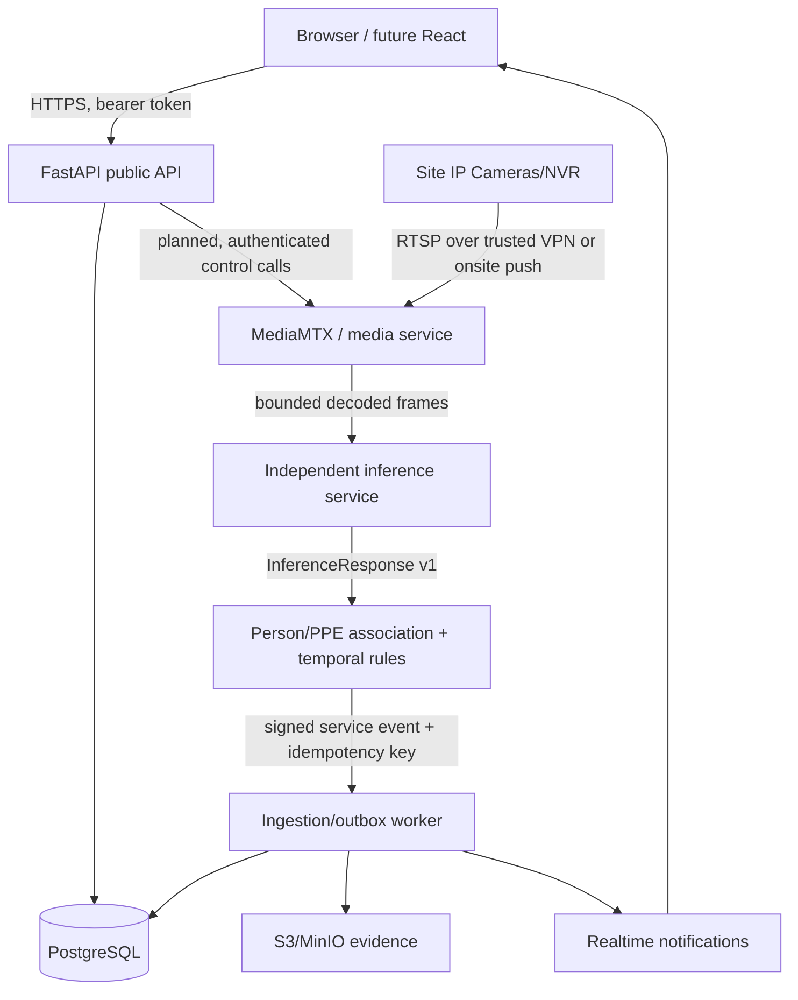

# Architecture & Explicit Trust Boundaries

## Intent

Keep the **Control Plane** (FastAPI, organization/site/camera/model selection, incidents, auth) independent of the **Media/Data Plane** (VPN/RTSP, decoding, sampling, AI inference) and the **Event Processing Plane** (rules, deduplication, outbox, evidence). Only the control plane is implemented in this repository today.

### API boundaries

- Public `/api/v1` handles user authorization, resources, queries, and audited control actions. **No full video decode**, `.pt` loading or GPU inference in this API.
- Planned `/internal/v1` must be isolated by **network policy + authenticated workload identity** (mTLS or a well-defined rotating service credential); never rely solely on a private IP or a user bearer token.
- Inference contract fields are described in `docs/INFERENCE_CONTRACT.md` and JSON schemas. `object_key` must be resolved against an allowlisted bucket/namespace by trusted services; **current Pydantic schema does not reject arbitrary URL-like object_key strings**. Add validation at trusted resolver and negative tests before implementing inference. Validate coordinates vs image dimensions at service boundary.
- Model registry in DB records metadata and artifact references only. Avoid cross-tenant assignments and untrusted artifact retrieval; verify sha256, version and source authority prior to loading in the inference service.
- Site cameras have `stream_ref` as a **nonsecret alias**. Actual camera credentials live in an approved secrets store and stay on media-side trust boundary. Cloud-pull needs server-to-camera reachability via VPN; if outbound-only, onsite relay/push is necessary.

### Reliability patterns to adopt later

- Bounded queues, backpressure, explicit frame drop policy for overload, per-camera scheduling fairness.
- Event idempotency IDs, transactional outbox and retry/dead-letter policies; do not keep job state only in process memory.
- Heartbeats, source health metrics and circuit breakers; graceful stream reconnect and recording continuity as requirements dictate.
- Evidence object retention, checksums and pre-signed URL authorization; PostgreSQL stores keys, not base64 payloads.
- Explicit contracts/migrations. Expose observability without leaking credentials, video frames or PII.

### Current known gaps

- Phase 1 `model_versions` table is **global** and has no owner or tenant visibility policy; Phase 2 must decide design **before** adding registry APIs.
- `incidents` has organization/site/camera FKs but does not enforce all tenant matches through composite DB constraints; incident writes are intentionally **not implemented**.
- `audit_logs` model exists, but there is **no complete, append-only audit recording service** for the existing site/camera writes.
- Actual media, inference, event workers and evidence services are not in the ZIP. All media-side arrows in the diagram are planned architecture.
