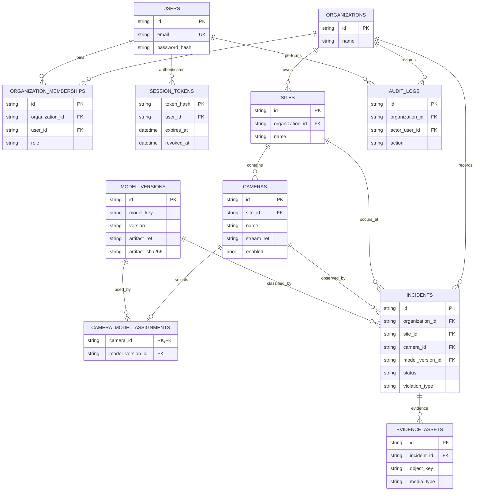

# PPE Construction V2 — ERD (Phase 1)

Source-to-target reconciliation:
- V1 `users`, `sessions` → V2 `users`, `session_tokens`, `organization_memberships`.
- V1 `cameras` → V2 `sites` + `cameras` with stream aliases; RTSP secrets NEVER stored in `stream_ref`.
- V1 `events` → V2 `incidents` and `evidence_assets`; Base64 evidence lives outside Postgres.
- V1 `settings` → planned `site_policies` (not yet implemented).
- New `model_versions` + `camera_model_assignments` make AI version selection independent of API.

## Phase 2 camera assignment revision and history

`cameras.model_revision` persists the optimistic revision through unassignment.
Existing cameras start at revision 0 and retain their current selections.
`camera_model_history` has primary key `(camera_id, revision)` and stores
the organization, actor, previous and new version IDs, and timestamp.
PostgreSQL rejects UPDATE, DELETE and TRUNCATE on history. Referenced cameras,
organizations, users and versions therefore require a history retention policy
before hard deletion is introduced.

## Decisions still needed before final production cutover

1. Retention, legal requirements and deletion semantics for incident evidence.
2. Camera/site role matrix (admin/operator/viewer) and per-camera permissions.
3. Scale constraints: multi-site camera counts, device connectivity, frame-rate targets.
4. Incident deduplication, time-based hysteresis, per-person tracking IDs.
5. Site policies, notification receipts, job persistence and camera health are phase 2 tables.
6. Tenant consistency for incident site_id/camera_id needs validated service-level inserts or composite FKs; currently only authorized incident reads are implemented.
